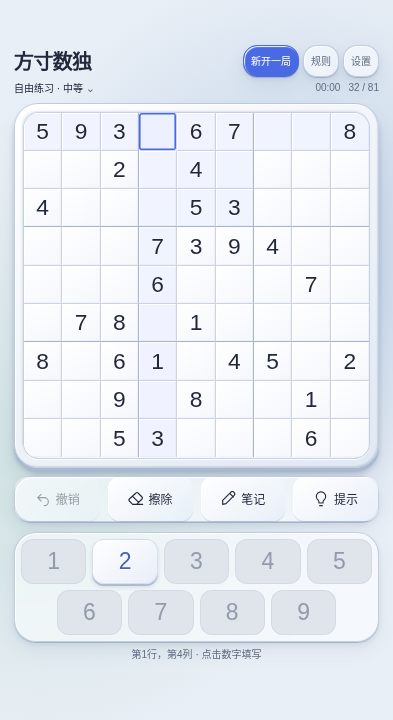
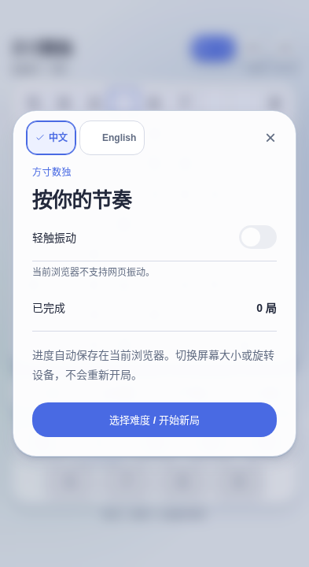

# 方寸数独 · Fangcun Sudoku

[简体中文](README.md) | **English**

A small space for focused reasoning. Built with [Taro 4](https://taro.zone/), React 18, and TypeScript, with **H5 (browser) output only**. The WeChat/Douyin mini-program and WeChat mini-game subprojects have been removed.
(For **React Native** or a native app, start a separate RN/Expo project; this repository is not an RN project.)

[](https://github.com/yuqiuqi/SudokuTaro)


## v1.2.5 · Bilingual documentation and consistent branding

The Chinese and English READMEs now link to each other. Product labels use **方寸数独 · Fangcun Sudoku**, while existing links and saved progress remain compatible. See [repository safeguards](docs/REPOSITORY_SECURITY.md) for the proposed protection settings and permission limits, and the [v1.2.5 notes](docs/releases/v1.2.5.md) for this update.

## v1.2.4 · Illustrated guidance and clearer controls

[Play online](https://yuqiuqi.github.io/SudokuTaro/)

New to Sudoku? Start with seven pages of illustrated guidance in Chinese and English: learn about rows, columns, and 3×3 boxes, then explore entering numbers, notes, erasing, undo, and free step-by-step hints. Full 9×9 diagrams explain each rule, including black given numbers, blue player entries, and gray disabled number keys.

A prominent “New game” entry at the top lets you choose a difficulty before starting; closing the dialog continues your current game. Every dialog offers explicit “中文 / English” choices. Softer grid lines and spacing between the four tool buttons make the controls easier to recognize and tap.

Vibration depends on browser support. iOS Safari does not support the Vibration API, so the settings explain why vibration is unavailable and disable the switch; H5 alone cannot enable haptic feedback in these browsers. Devices that support the API can still use vibration according to the saved preference.

| 393×720 · Main game | 393×720 · Language and vibration settings |
|---|---|
|  |  |

These screenshots were captured in Chromium over loopback from the v1.2.4 production build with the Pages subpath: the main screen shows an actual newly generated Medium puzzle with 32 givens; the settings screenshot simulates the absence of the Vibration API and is not evidence of testing on a physical iOS device. Type checking, 26 logic tests, and the full browser regression suite for both root-path and Pages builds passed for v1.2.4. See the [v1.2.4 release notes](docs/releases/v1.2.4.md) for changes and verification scope, and [Responsive Design](docs/RESPONSIVE_DESIGN.md) for layout rules. Refer to [GitHub Actions](https://github.com/yuqiuqi/SudokuTaro/actions), [GitHub Releases](https://github.com/yuqiuqi/SudokuTaro/releases), and [pull requests](https://github.com/yuqiuqi/SudokuTaro/pulls) for remote build, deployment, and official release status.

## Features

- **Interface and responsive layout:** misty blue and pale cyan glows, a solid board, a glass tool tray, and raised number keys. The layout adapts to the browser's actual available width and height on phones, in landscape, and in split-screen regions; rotation and split-screen changes preserve progress.
- **Input:** select an editable cell and tap the always-visible 1–9 keys without opening the system keyboard. Conflicting number keys are disabled and distinguished by color; attempting input without a selected cell still prompts you to select one first. Physical keyboards support number keys, arrow keys, Delete/Backspace, N to toggle notes, and Escape to close dialogs. Conflicting input from a physical keyboard is rejected with feedback.
- **Notes and undo:** record multiple candidates in each cell. Entering a number clears related candidates; undo restores numbers and notes. Erase and undo are free, with no stamina limit.
- **Free step-by-step hints:** locate the relevant area → consider eliminations → read the reasoning. Full explanations appear outside the board, controls stay in place, and players enter the answer themselves.
- **Getting started and new games:** seven illustrated tutorial pages in Chinese and English. The top new-game entry asks for a difficulty before starting; canceling preserves the current game. Each dialog lets you select Chinese or English directly.
- **Rules and puzzle generation:** new puzzles strictly use 36–40 givens for Easy, 31–35 for Medium, and 26–30 for Hard, with a unique-solution check. Existing saves are unchanged. Grouping puzzles by clue count is not a professional rating of the logical techniques required.
- **Completion:** an approximately 2.4-second rainbow 3D wave → approximately 650 ms of lime light along the grid seams → results and personal records. Supports reduced motion, skipping the animation, admiring the board, and playing again; refreshing does not count a win twice.
- **Saving:** progress, records, language, and vibration preferences are saved in the current browser; play remains available when storage is unavailable. Browsers without the Vibration API show a disabled switch with an explanation; a saved vibration preference cannot enable unsupported functionality.

## Technology stack

| Category | Technology |
|------|------|
| Framework | Taro 4.3.0, React 18.3.1 |
| Language | TypeScript 7.0.2 |
| Styles | Sass, CSS variables, actual CSS pixels (`pxtransform` disabled for H5) |
| Build | Webpack 5 (`@tarojs/webpack5-runner`) |

## Requirements

- **Node.js** 22+ (CI uses 22; a supported LTS version is recommended)
- **npm**, **cnpm**, **pnpm**, or **yarn**
- A modern browser (H5)

## Install dependencies

```bash
cd SudokuTaro
npm install
```

## Development and builds

| Command | Description |
|------|------|
| `npm run dev:h5` | H5 development (webpack-dev-server, commonly on port `10086`) |
| `npm run build:h5` | H5 production build, written to `dist/` |
| `npm run typecheck` | TypeScript checks |
| `npm test` | Logic tests for puzzle generation, notes, hints, undo, and saves |
| `npm run test:browser` | Viewport and interaction tests after building (first run `npx playwright install chromium`) |

To preview H5 locally, run `npm run dev:h5` and open the address printed in the terminal, such as `http://localhost:10086/`.

## Project structure (overview)

```
SudokuTaro/
├── config/
│   └── index.ts          # Taro (H5 only)
├── scripts/              # Optional Git / GitHub helper scripts
├── src/
│   ├── app.tsx
│   ├── app.config.js
│   ├── index.html
│   ├── pages/index/      # Main Sudoku interface
│   └── utils/            # Sudoku engine, game state, development diagnostics
├── package.json
└── README.md
```

## Configuration notes

- **`config/index.ts`:** `h5.publicPath: '/'`; `h5.devServer.static: false` prevents the development server from showing a static directory listing at the root path.
- **Page configuration:** `app.config.js` and `pages/index/index.config.js` use plain JavaScript to avoid accessing `window` when Node reads the configuration.

## Verification and collaboration

Install Chromium before running browser tests for the first time. After each round of code changes, run the following in order:

```bash
npm run typecheck
npm test
npm run build:h5
npx playwright install --with-deps chromium
npm run test:browser
```

GitHub Pages requires a subpath build and its matching tests; do not mix these with root-path build artifacts:

```bash
GITHUB_PAGES=true npm run build:h5
PAGES_BUILD=true npm run test:browser
```

Use `SCREENSHOT_DIR=/tmp/sudoku-ui npm run test:browser` to save screenshots from a real browser. Browser simulation does not replace testing on physical devices with iOS Safari or mobile Edge, with screen readers, or on foldable hardware. See the release notes for online resource verification methods and areas not yet verified.

Contributors should first read [AGENTS.md](AGENTS.md) and [CONTEXT.md](CONTEXT.md). See the [dependency upgrade record](docs/DEPENDENCY_UPGRADE.md) for dependency maintenance and Taro compatibility constraints.

## Repository safeguards

This repository remains public; cloning, downloading, and copying its source cannot be disabled. Branch protection restricts pushes and merges; it does not keep source code confidential, and the license does not block downloads.

GitHub returned 403 for this connection’s requests to configure `main` protection and update the repository description; neither change has been applied. See [Repository Security](docs/REPOSITORY_SECURITY.md) for the proposed configuration, required Administration permissions, and administrator setup and verification steps. A prepared configuration file does not prove that protection is active.

## Troubleshooting

- **PowerShell cannot run npm:** check that Node is on `PATH`, or use `npm.cmd`. If the execution policy blocks `.ps1` files, use cmd.
- **The H5 root path shows a directory listing:** check `src/index.html` and `h5.devServer.static: false`; this repository already includes that configuration.
- **Dependency or Babel build errors:** first run `npm ci` using the lockfile, then check Node.js 22+ and the [dependency compatibility record](docs/DEPENDENCY_UPGRADE.md).

## License

This repository uses [**CC BY-NC-ND 4.0**](https://creativecommons.org/licenses/by-nc-nd/4.0/) (Attribution–NonCommercial–NoDerivatives): subject to its terms, **noncommercial copying and sharing of the original** are permitted with attribution. You may produce and reproduce adapted material for noncommercial purposes, but **must not share adapted material**; this license does not authorize commercial use. See [`LICENSE`](./LICENSE) in the repository root for the full terms.

> Note: Creative Commons licenses are commonly used for creative works and documentation. If you intend to redistribute the code as typical “open-source software,” assess whether that use is compatible with this license and consult a legal professional if needed.

---

**Note:** `node_modules/`, `dist/`, `.taro/`, and similar generated directories are excluded through `.gitignore`; do not commit them to Git.
