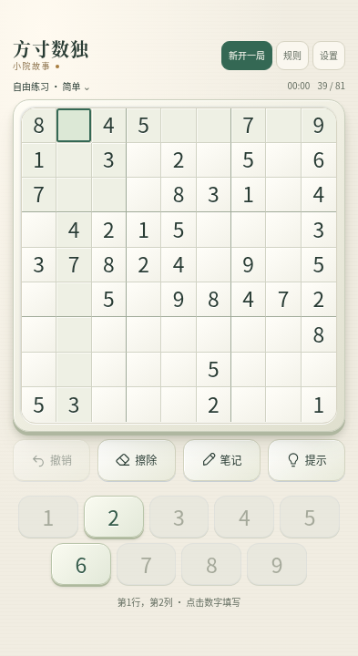
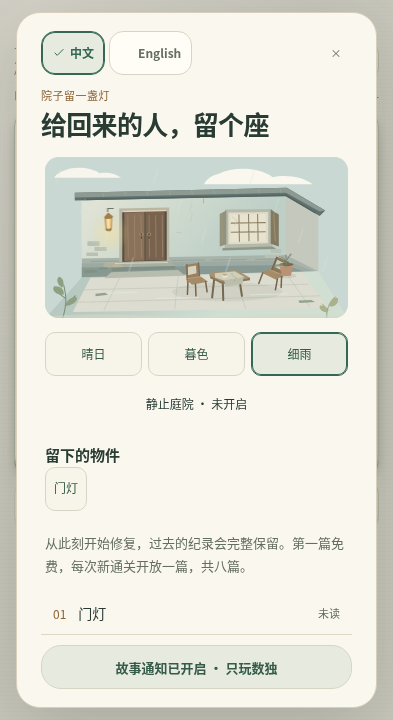

# 方寸数独 · Fangcun Sudoku

[简体中文](README.md) | **English**

A quiet puzzle table and a courtyard slowly made welcoming again. This branch is a **2.0.0 candidate**, built for the browser with React 18, Vite and TypeScript. It introduces warm ceramic surfaces, green controls, original SVG scenery and eight complete bilingual chapters of *A Light in the Courtyard*. The SudokuTaro repository name, Pages URL and legacy save identifiers remain compatible; Taro has been removed from the current runtime.

**Unreleased; final user review is required.** The [online game](https://yuqiuqi.github.io/SudokuTaro/) remains the existing v1.3.0, not this candidate. This round must not merge, push main, deploy, tag or publish a release. Historical evidence remains in the [v1.3.0 notes](docs/releases/v1.3.0.md).

## Puzzles and the courtyard

- An 81-cell native DOM board and permanent 1–9 keys avoid opening the software keyboard. Physical keys, arrows, notes, erase, undo and free layered hints remain. Givens are read-only; conflicting entries never enter the board.
- Easy disables conflicting digits in the selected row, column or box. Medium and Hard retain all nine keys and manual candidates. New puzzles have unique solutions with 36–40 / 31–35 / 26–30 givens; these bands do not rate expert solving techniques.
- Seven bilingual tutorial pages include five-step demonstrations in the first three lessons. Real animation events connect the victory wave, lime seam light and results. “See the glow” neither records another win nor unlocks a chapter.
- Chapter one is free; each genuinely new win unlocks one more, up to eight. Seven new wins finish Volume One. All difficulties and free hints count equally; old wins do not retroactively unlock chapters, and records stay intact. Lin He, her sister Lin Zhao and their neighbour Aunt Tao learn to agree on closeness, care and their separate lives while restoring the courtyard.
- **Life in the courtyard:** after unlocking all eight main chapters, twelve further first-time wins open twelve complete bilingual notes and six pairs of everyday scene details. The final main-chapter win does not award a note too; refresh and encore award nothing. The collection is finite.
- **Make the courtyard yours:** choose daylight, dusk or gentle rain, switch to a still scene, inspect restored objects and keep one favorite in view. Preferences save locally; weather does not follow real dates or change puzzle difficulty or rewards.
- Open the story voluntarily and reread any unlocked chapter. Sudoku-only mode hides notices while continuing to earn chapters and keeping manual access. There are no accounts, cloud saves, energy, daily streaks, live events, paid or ad-gated chapters, or promises of endless story.
- Browser storage keeps the puzzle, records, language, vibration preference and separate story progress. Undo restores only board values and notes; history does not survive refresh. Play continues in memory if storage fails. Cross-key transactions and consistency across concurrent tabs are not guaranteed.
- Input and first unit completion use local feedback. The scene changes through eight stages; reduced motion and hidden-page handling stop relevant effects. Vibration requires the browser Vibration API and is disabled with an explanation when unsupported.

[Review the complete candidate and video](docs/reviews/COURTYARD_V2_CANDIDATE.md)

| Ceramic puzzle table | Player-selected gentle rain |
|---|---|
|  |  |

## Run locally

Use Node.js **>=22.12.0**, npm and a modern browser:

```bash
npm ci
npm run dev:h5
```

Open `http://localhost:10086/`. The `h5` script names remain compatible with existing workflows; Vite now runs them.

| Command | Purpose |
|---|---|
| `npm run typecheck` | TypeScript checking |
| `npm test` | Node logic and storage tests |
| `npm run build:h5` | Root-path production build in `dist/` |
| `npm run test:browser` | Full Playwright regression against the latest build |
| `COURTYARD_ONLY=true npm run test:browser` | Targeted courtyard browser checks |

Run the complete checks with matching root and Pages artifacts:

```bash
npm run typecheck
npm test
npm run build:h5
npx playwright install --with-deps chromium
npm run test:browser
COURTYARD_ONLY=true npm run test:browser
GITHUB_PAGES=true npm run build:h5
PAGES_BUILD=true npm run test:browser
PAGES_BUILD=true COURTYARD_ONLY=true npm run test:browser
```

Do not mix root and `/SudokuTaro/` builds. Legacy `#/pages/index/index` links still open the same app without a new routing service. `SCREENSHOT_DIR` saves browser screenshots; see [Responsive Design](docs/RESPONSIVE_DESIGN.md) for runner configuration.

## Technology and references

| Layer | Current implementation |
|---|---|
| UI | React 18.3.1, React DOM, native buttons |
| Build | Vite 8.3.8, React plugin 6.3.0 |
| Language and styles | TypeScript 7.0.2, Sass, CSS variables, actual CSS pixels |
| Rules and state | Pure Sudoku rules, session hook, storage repository, pure story functions |
| Art and narrative | Original AI-assisted SVG, CSS and eight bilingual chapters; no remote fonts or external images |

The entry is root `index.html` → `src/main.tsx` → `src/app.tsx`. Rules live in `src/utils/`, session and presentation in `src/features/game/`, story in `src/features/courtyard/`, and browser storage in `src/platform/storage.ts`. No Canvas engine, ECS or per-frame game loop is required.

[All twelve life notes for review](docs/story/COURTYARD_LIFE_NOTES.md) · [New reference adoption](docs/CLAUDE_GAME_STUDIOS_ADOPTION.md) · [Full story for review (including ending)](docs/story/COURTYARD_STORY.md) · [Architecture and story contracts](docs/architecture/COURTYARD_V2.md) · [Responsive Design](docs/RESPONSIVE_DESIGN.md) · [Skills installation and use](docs/GAMEDEV_SKILLS.md) · [Asset provenance](docs/art/courtyard-assets.json) · [Design specification](docs/superpowers/specs/2026-11-11-courtyard-redesign-design.md)

## Verification status and limits

The same frozen candidate passes type checking, 60 logic tests, builds without warnings, existing/new-world browser checks, 1176 geometry states including inner text bounds, and complete matching root/Pages browser regressions (441.30s/451.73s, no runtime errors). The [candidate review entry](docs/reviews/COURTYARD_V2_CANDIDATE.md) provides 13 real screenshots, a continuous 10.92-second video, disclosed save fixtures and exact same-host JS/CSS measurements. Remote CI must be checked on the actual PR head; final user approval remains pending.

Viewport and segment simulations are not real Xiaomi 17 mobile Edge, iOS Safari, folding hardware or screen-reader tests. Real-device frame rate, tactile quality and retention improvements have not been established. Refer to the actual PR, [Actions](https://github.com/yuqiuqi/SudokuTaro/actions) and [Releases](https://github.com/yuqiuqi/SudokuTaro/releases) for delivery and publication status.

Read [AGENTS.md](AGENTS.md) and [CONTEXT.md](CONTEXT.md) before contributing. Taro/Webpack constraints in the [dependency history](docs/DEPENDENCY_UPGRADE.md) describe the old toolchain. Public source can be cloned; branch protection does not make it private. Historical administration limits are documented in [Repository Security](docs/REPOSITORY_SECURITY.md).

## License

The project uses [CC BY-NC-ND 4.0](LICENSE): attributed noncommercial sharing of the original is permitted under its terms; sharing adaptations and commercial use are not authorized. The upstream gamedev skills have their own Apache-2.0 license, which does not change the project license. Do not commit generated `node_modules/` or `dist/` files.
