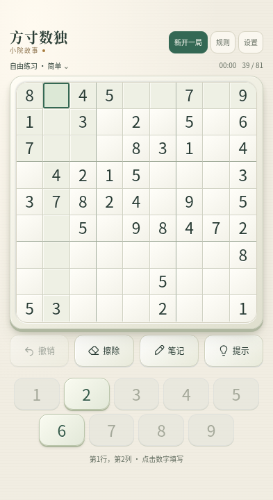
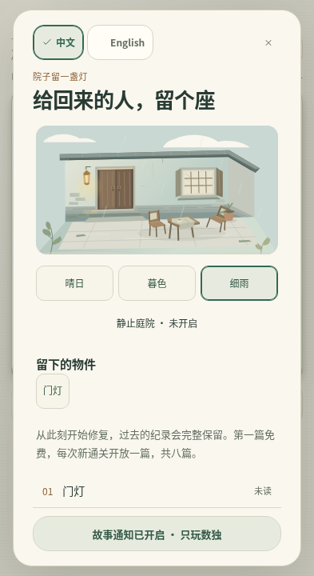

# 方寸数独 · Fangcun Sudoku

**简体中文** | [English](README.en.md)

一张安静的解题桌，一座慢慢修好的旧院。当前分支是 **2.0.0 候选**：React 18 + Vite + TypeScript 的浏览器游戏，暖瓷棋盘、墨绿工具与原创 SVG 庭院，附八篇中英文亲情故事《院子留一盏灯》。仓库名 SudokuTaro、Pages URL 和旧存档标识保留兼容；当前运行时已移除 Taro。

**尚未发布，等待用户最终审核。** [在线版本](https://yuqiuqi.github.io/SudokuTaro/)仍为既有 v1.3.0，不是本候选预览。本轮不合并、不推送 main、不部署、不打标签、不发布 Release；历史版本见 [v1.3.0 说明](docs/releases/v1.3.0.md)。

## 游戏与旧院

- 原生 DOM 的 81 格棋盘和常驻 1–9 数字键，不唤起软键盘；支持物理键盘、方向键、笔记、擦除、撤销与免费分层提示。给定数只读，冲突填数拒绝入盘。
- 简单模式禁用当前行／列／宫冲突数字；中等／困难保留九键及手工候选。新题检查唯一解，给定数分别为 36–40／31–35／26–30；这不是专业解题技巧评级。
- 七页中英文教程，前三课提供五步演示；真实动画事件衔接通关彩虹波浪、青柠缝隙光与结果。「再赏流光」不重复记分或发章。
- 首篇故事免费；此后每次真正的新胜局开放一篇，七次可读完第一卷。所有难度和免费提示平等；旧胜场不倒填，旧纪录保留。林禾、姐姐林照与邻居陶姨在修院中重新商量亲近、照顾与各自生活。
- **院中日常**：八篇主线解锁后，再以十二个首次新胜局收齐十二笺完整中英日常，六组物件各有两层变化。解锁主线末篇的同一局不双发，刷新／再赏不发奖；全部内容有限。
- **自己的院子**：选择晴日、暮色或细雨，切换静止庭院，观察已修复物件并选择一件「留在眼前」；偏好本地保存，天气不依赖真实日期，也不改变解题难度或奖励。
- 故事主动打开、可重读；「只玩数独」关闭通知，继续累计解锁并保留手动入口。没有账号、云同步、体力、签到、真实日期事件、付费或广告解锁，也不承诺无限故事。
- 本地保存棋局、纪录、语言、振动偏好与独立故事进度。撤销只恢复棋盘／笔记，历史不跨刷新保存。存储不可用时仍可当次游玩；不保证跨 key 事务或多标签并发一致性。
- 输入和首次完成单元只有局部轻反馈，庭院随八章变化；减少动态效果与页面隐藏时停止相应动效。振动取决于浏览器 Vibration API，缺失时禁用并说明。

[查看完整候选审核与视频](docs/reviews/COURTYARD_V2_CANDIDATE.md)

| 暖瓷棋盘 | 自选细雨庭院 |
|---|---|
|  |  |

## 本地运行

需要 Node.js **>=22.12.0**、npm 和现代浏览器。依赖使用锁文件复现：

```bash
npm ci
npm run dev:h5
```

开发地址为 `http://localhost:10086/`。脚本保留 `h5` 名称以兼容已有工作流，当前由 Vite 执行。

| 命令 | 用途 |
|---|---|
| `npm run typecheck` | TypeScript 检查 |
| `npm test` | Node 逻辑与存档测试 |
| `npm run build:h5` | 根路径生产构建至 `dist/` |
| `npm run test:browser` | 对最新构建运行完整 Playwright 回归 |
| `COURTYARD_ONLY=true npm run test:browser` | 庭院专项浏览器检查 |

完整验证及 Pages 配对构建：

```bash
npm run typecheck
npm test
npm run build:h5
npx playwright install --with-deps chromium
npm run test:browser
COURTYARD_ONLY=true npm run test:browser
GITHUB_PAGES=true npm run build:h5
PAGES_BUILD=true npm run test:browser
PAGES_BUILD=true COURTYARD_ONLY=true npm run test:browser
```

根路径与 `/SudokuTaro/` 产物不能混用。旧 `#/pages/index/index` 链接仍可进入同一应用，不依赖新增路由服务。截图可用 `SCREENSHOT_DIR` 保存；浏览器运行配置见 [适配说明](docs/RESPONSIVE_DESIGN.md)。

## 技术与设计依据

| 层 | 当前实现 |
|---|---|
| UI | React 18.3.1、React DOM、原生按钮 |
| 构建 | Vite 8.3.8、React 插件 6.3.0 |
| 语言与样式 | TypeScript 7.0.2、Sass、CSS 变量与实际 CSS px |
| 规则与状态 | 纯数独算法、游戏会话 hook、独立存档仓库和故事纯函数 |
| 美术与叙事 | 原创、AI 辅助编写的 SVG／CSS／八章双语文本；无远程字体或外部图片 |

入口是根 `index.html` → `src/main.tsx` → `src/app.tsx`；规则在 `src/utils/`，会话和演出在 `src/features/game/`，故事在 `src/features/courtyard/`，浏览器存档统一在 `src/platform/storage.ts`。没有引入 Canvas、ECS 或每帧游戏循环。

[十二笺审核全文](docs/story/COURTYARD_LIFE_NOTES.md) · [新参考采用记录](docs/CLAUDE_GAME_STUDIOS_ADOPTION.md) · [故事审核全文（含结局）](docs/story/COURTYARD_STORY.md) · [架构与故事契约](docs/architecture/COURTYARD_V2.md) · [自适应设计](docs/RESPONSIVE_DESIGN.md) · [技能安装与使用记录](docs/GAMEDEV_SKILLS.md) · [资产来源清单](docs/art/courtyard-assets.json) · [设计规格](docs/superpowers/specs/2026-11-11-courtyard-redesign-design.md)

## 验证状态与边界

同一冻结候选已通过类型检查、60项逻辑、无warning构建、原庭院／新世界专项、含文字内部边界的1176例几何诊断，以及最新根路径／Pages配对完整浏览器（441.30s／451.73s，运行时错误为空）。13张实际截图、10.92秒连续视频、受控存档来源与同机JS/CSS精确测量见[候选审核入口](docs/reviews/COURTYARD_V2_CANDIDATE.md)。准确head远端CI以本分支实际PR为准，最终用户审核仍待完成。

浏览器尺寸／分区模拟不等于小米 17 移动 Edge、iOS Safari、真实折叠硬件或屏幕阅读器实测；未证明真实设备帧率、触感或留存提升。交付与发布状态以实际 PR、[Actions](https://github.com/yuqiuqi/SudokuTaro/actions) 和 [Releases](https://github.com/yuqiuqi/SudokuTaro/releases) 为准。

协作先读 [AGENTS.md](AGENTS.md) 与 [CONTEXT.md](CONTEXT.md)。[依赖升级记录](docs/DEPENDENCY_UPGRADE.md) 中的 Taro／Webpack 限制属于旧工具链历史，不是当前安装要求。公开仓库可被克隆；分支保护不提供源码保密，历史权限状态见 [仓库安全说明](docs/REPOSITORY_SECURITY.md)。

## 许可证

项目采用 [CC BY-NC-ND 4.0](LICENSE)，允许依条款署名的非商业原作分享，禁止分享改编材料，商业使用未获授权。上游 gamedev 技能的 Apache-2.0 许可独立适用，不改变本项目许可。`node_modules/`、`dist/` 等生成内容不应提交。
