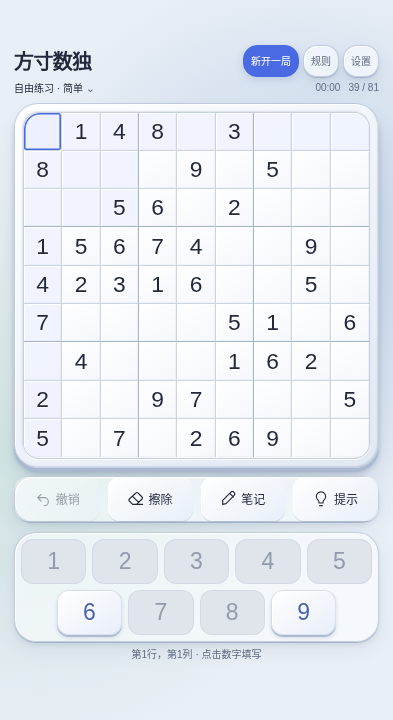
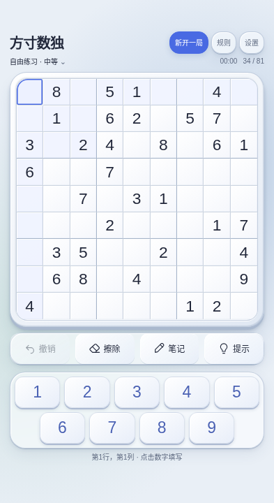
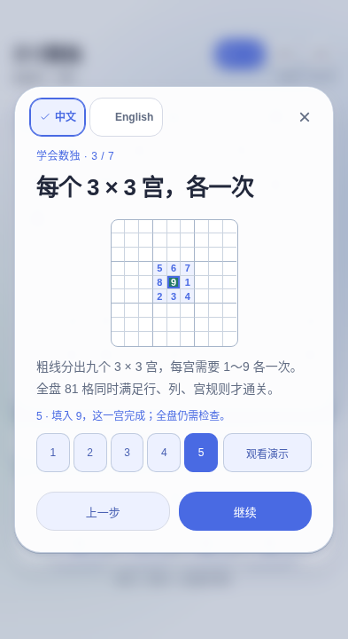

# 方寸数独 · Fangcun Sudoku

**简体中文** | [English](README.en.md)

方寸之间，专注推演。基于 [Taro 4](https://taro.zone/) + React 18 + TypeScript，**仅输出 H5**（浏览器），已移除微信/抖音小程序与微信小游戏子工程。
（若你需要 **React Native** 或原生 App，需另起 RN/Expo 工程；本仓不是 RN 项目。）

[](https://github.com/yuqiuqi/SudokuTaro)


## v1.3.0 · 自主挑战、再赏流光与分步教学

[在线试玩](https://yuqiuqi.github.io/SudokuTaro/)

简单模式继续将行、列、宫中冲突的数字键变灰并禁用；中等和困难保留 1～9 全部可选，也允许手工记录错误候选。可选不代表正确：正式填数仍会拒绝冲突并提示，非法数字不会进入棋盘。已填格不能写笔记、给定格只读、通关后不能继续填数。

通关后可在成绩卡或完成棋盘点击「再赏流光」，再次欣赏彩虹立体波浪与青柠缝隙光，再回到成绩；不改变棋盘、用时、胜场或保存，也不重复胜利振动。开启减少动态效果时，入口禁用并显示原因。

七页中英文教程的前三课提供行、列、3×3 宫五步演示：识别范围、观察八个数字、找出缺少的 9、选中中央空格、填入并验证。默认静止，可手动选择 1～5，或观看每步 1600ms、到末步停止的演示；切页、关闭、隐藏页面或开启减少动态效果会停止自动演示。其他四课继续介绍填数、工具、免费提示与保存。

上方「新开一局」按钮去除白色内边沿，保留原布局、焦点环与先选难度再替换的行为。各弹窗继续提供明确的中文／English 选择。振动仍取决于 Vibration API 支持；不支持时禁用并说明原因。

本轮已通过类型检查、34 项逻辑测试、根路径与 Pages 子路径配对生产构建及完整浏览器回归；另有十视口、双语及两种动效偏好的教学／通关卡几何诊断 800 例、失败 0。两路径构建仍保留约 282KiB 入口超过建议 244KiB 的体积提示。本轮五张截图来自配对 Pages 生产构建的回环 Chromium，实际来源与验证范围详见 [v1.3.0 更新说明](docs/releases/v1.3.0.md)。历史界面截图及其来源保留于 [v1.2.4 更新说明](docs/releases/v1.2.4.md)，不能代表本轮新功能。适配规则见 [自适应设计](docs/RESPONSIVE_DESIGN.md)。远端构建、部署与正式发布状态以 [GitHub Actions](https://github.com/yuqiuqi/SudokuTaro/actions)、[GitHub Releases](https://github.com/yuqiuqi/SudokuTaro/releases) 和 [PR 记录](https://github.com/yuqiuqi/SudokuTaro/pulls) 为准。

| 简单：冲突数字禁用 | 中等：九键可选 | 教程：手动第 5 步 |
|---|---|---|
|  |  |  |

[568×240 英文教学扫描帧](docs/screenshots/challenge-demo-568x240-en.png) · [通关与再赏入口](docs/screenshots/challenge-victory-393x720.png)。新局分别实际生成 39／34 个给定数；横屏扫描暂停于真实 450ms 帧，通关图使用受控临近完成存档，经实际填数和原胜利动画到达成绩。截图均非真机实测。

## 功能概览

- **界面与适配**：雾蓝与浅青光晕、实体棋盘、玻璃工具托盘与凸起数字键帽；按浏览器实际可用宽高适配手机、横屏与分区，旋转和分屏保留进度。
- **输入**：选可编辑格后点击常驻 1～9，不唤起系统键盘。简单模式的冲突数字键禁用并以颜色区分，中等／困难保留九键；未选格时仍提示先选格。支持物理数字键、方向键、Delete／Backspace、N 切换笔记、Escape 关闭弹层；物理键盘输入冲突数字时保留拒绝反馈。
- **笔记与撤销**：空白可编辑格可记录多个候选数，简单模式过滤冲突候选，中等／困难由玩家判断；填数清理相关候选，撤销恢复数字与笔记。擦除、撤销免费，无体力限制。
- **免费分层提示**：观察位置 → 排除思考 → 推理解释；全文显示在棋盘外，按钮位置稳定，答案由玩家亲手填写。
- **新手与新局**：七页中英文图解教程，前三课支持手动五步与有限自动演示；上方新局入口先选难度再开始，取消保留原局。各弹窗可直接选择中文或 English。
- **规则与出题**：新局实际给定数字按简单 36–40／中等 31–35／困难 26–30 严格分档，检查唯一解；旧存档不变。线索数量分档不等于专业逻辑技巧评级。
- **通关**：约 2.4 秒彩虹立体波浪 → 约 650ms 青柠缝隙光 → 成绩与个人纪录；支持减少动态效果、跳过、欣赏棋盘、再赏流光与再挑战，刷新和再赏不重复记胜场。
- **保存**：进度、纪录、语言与振动偏好保存在当前浏览器；存储不可用时仍可游玩。不支持 Vibration API 时开关不可用并说明原因，已保存的振动偏好不会使其生效。

## 技术栈

| 类别 | 选用 |
|------|------|
| 框架 | Taro 4.3.0、React 18.3.1 |
| 语言 | TypeScript 7.0.2 |
| 样式 | Sass、CSS 变量、实际 CSS 像素（H5 关闭 pxtransform） |
| 构建 | Webpack 5（`@tarojs/webpack5-runner`） |

## 环境要求

- **Node.js** 22+（CI 使用 22；建议使用受支持的 LTS）
- **npm** 或 **cnpm** / **pnpm** / **yarn**
- 现代浏览器（H5）

## 安装依赖

```bash
cd SudokuTaro
npm install
```

## 开发与构建

| 命令 | 说明 |
|------|------|
| `npm run dev:h5` | H5 开发（webpack-dev-server，常见端口 `10086`） |
| `npm run build:h5` | H5 生产构建，输出 `dist/` |
| `npm run typecheck` | TypeScript 检查 |
| `npm test` | 出题、笔记、提示、撤销与存档逻辑测试 |
| `npm run test:browser` | 构建后运行多视口与交互测试（先 `npx playwright install chromium`） |

H5 本地预览：`npm run dev:h5` 后在浏览器打开终端提示地址（如 `http://localhost:10086/`）。

## 项目结构（摘要）

```
SudokuTaro/
├── config/
│   └── index.ts          # Taro（仅 H5）
├── scripts/              # 可选：Git / GitHub 辅助脚本
├── src/
│   ├── app.tsx
│   ├── app.config.js
│   ├── index.html
│   ├── pages/index/      # 数独主界面
│   └── utils/            # 数独引擎、游戏状态、开发诊断
├── package.json
└── README.md
```

## 配置说明（要点）

- **`config/index.ts`**：`h5.publicPath: '/'`；`h5.devServer.static: false` 避免开发时根路径被当成静态目录列表。
- **页面配置**：`app.config.js`、`pages/index/index.config.js` 使用纯 JS，避免在 Node 读取配置时触发 `window`。

## 验证与协作

首次运行浏览器测试需安装 Chromium；每轮代码修改后按顺序执行：

```bash
npm run typecheck
npm test
npm run build:h5
npx playwright install --with-deps chromium
npm run test:browser
```

GitHub Pages 使用子路径构建与对应测试，不能与根路径产物混用：

```bash
GITHUB_PAGES=true npm run build:h5
PAGES_BUILD=true npm run test:browser
```

`SCREENSHOT_DIR=/tmp/sudoku-ui npm run test:browser` 可保存真实浏览器截图。浏览器模拟不代替真实 iOS Safari、移动 Edge、屏幕阅读器及折叠硬件测试；线上资源验证方式与未验证范围见更新说明。

协作者先阅读 [AGENTS.md](AGENTS.md) 和 [CONTEXT.md](CONTEXT.md)。依赖维护与 Taro 兼容约束见 [依赖升级记录](docs/DEPENDENCY_UPGRADE.md)。

## 仓库保护与源码访问

本仓库保持公开，因此无法禁止克隆、下载或复制源码。主分支保护用于限制推送和合并，不提供源码保密；许可证也不是下载拦截措施。

本次连接对 main 保护和仓库简介更新均收到 GitHub 403，尚未应用。具体配置、所需 Administration 权限与管理员操作／核验方式见 [仓库安全说明](docs/REPOSITORY_SECURITY.md)。配置文件准备好不等于已生效。

## 常见问题

- **PowerShell 无法运行 npm**：确认 Node 已加入 PATH，或使用 `npm.cmd`；执行策略限制 `.ps1` 时可使用 cmd。
- **H5 根路径显示目录列表**：检查 `src/index.html` 与 `h5.devServer.static: false`，本仓库已配置。
- **依赖或 Babel 构建错误**：先使用锁文件执行 `npm ci`，并核对 Node.js 22+ 与 [依赖兼容记录](docs/DEPENDENCY_UPGRADE.md)。

## 许可证

本仓库采用 [**CC BY-NC-ND 4.0**](https://creativecommons.org/licenses/by-nc-nd/4.0/deed.zh-Hans)（署名-非商业性使用-禁止演绎）：依条款允许**非商业复制和分享原作**，须保留署名；可为非商业目的制作和复制改编材料，但**不得分享改编材料**，商业使用不获本许可授权。完整条款见仓库根目录 [`LICENSE`](./LICENSE)。

> 说明：CC 许可常用于作品与文档；若你需将代码以典型「开源软件」方式再分发，请自行评估是否与本许可兼容，必要时咨询法律专业人士。

---

**说明**：`node_modules/`、`dist/`、`.taro/` 等已通过 `.gitignore` 忽略，勿提交到 Git。
