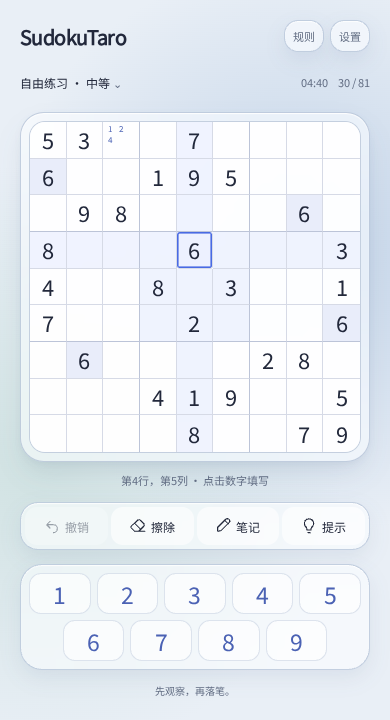
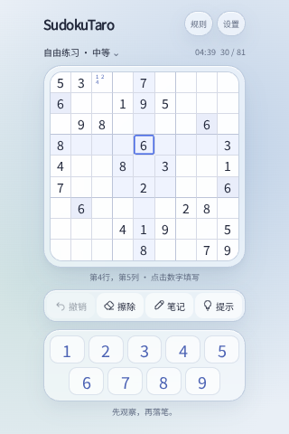
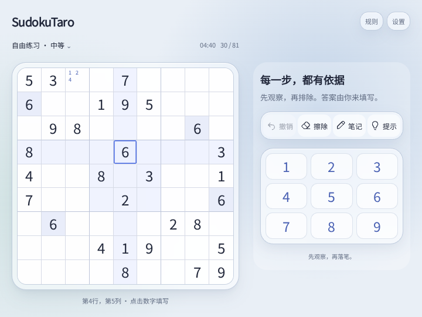
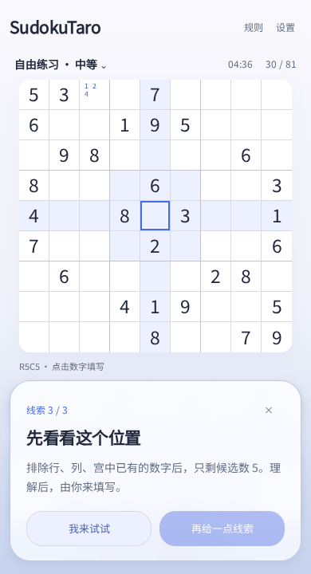
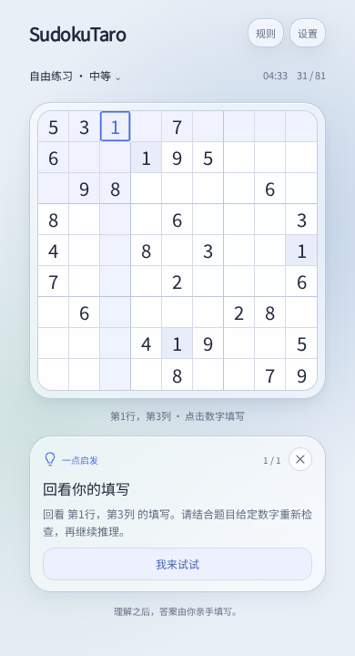
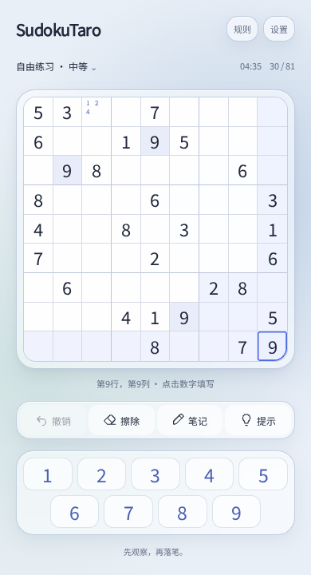
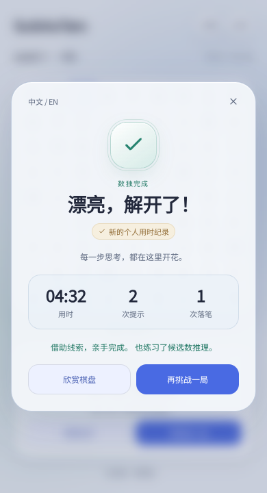
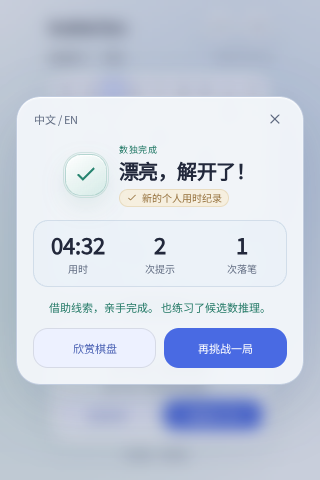
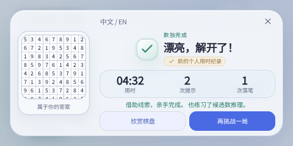

# SudokuTaro

数独 — 基于 [Taro 4](https://taro.zone/) + React 18 + TypeScript，**仅输出 H5**（浏览器），已移除微信/抖音小程序与微信小游戏子工程。  
（若你需要 **React Native** 或原生 App，需另起 RN/Expo 工程；本仓不是 RN 项目。）

[](https://github.com/yuqiuqi/SudokuTaro)


## v1.1.0 依赖维护

Taro 全套升级至 4.3.0，TypeScript 升级至 7.0.2，Playwright 升级至 1.64.1，并更新 Sass、PostCSS、Babel 7 补丁和类型定义；游戏设计与存档格式保持不变。构建环境要求 Node.js 22+。

React 仍为 18.3.1；Taro 当前的兼容约束要求保留 React 18、Webpack 5.91.0、Babel 7、ESLint 8 和 react-refresh 0.14.x。每个直接依赖的升级、清理或保留原因见 [完整依赖记录](docs/DEPENDENCY_UPGRADE.md)，执行步骤见 [升级计划](docs/superpowers/plans/2026-10-19-dependency-upgrade.md)。

## 功能概览

- **界面**：按已确认的 [Figma 设计](https://www.figma.com/design/AhWwkAjjXti2imJAbhgrTY?node-id=20-545) 实现雾蓝光晕背景、细边框悬浮棋盘、玻璃工具栏与独立数字区，竖屏内容与棋盘左右对齐。
- **适配**：按浏览器实际可用宽高切换常规、紧凑、极短、宽屏布局。主游戏页无双向滚动；旋转、展开与分屏重排保留进度。
- **输入**：选格后点击常驻 1～9；不使用隐藏输入框，不唤起系统键盘。物理键盘支持数字、方向键、Delete / Backspace、N 切换笔记、Escape 关闭弹层。
- **笔记**：每格可记录多个候选数，重复点击取消；填数后清理相关候选数，撤销同时恢复数字和笔记。
- **提示**：灯泡图标 + 观察位置 → 排除思考 → 推理解释。使用「第几行、第几列」说明位置，重复内容只展示一次，有不同信息时才逐步展开；卡片在棋盘外替换操作区，有独立关闭按钮，提示不会自动填答案。
- **规则**：中英文分步教学；简单 / 中等 / 困难按留空数量区分，生成的题目均检查唯一解。
- **参与感**：最后落笔后，九宫格柔光与少量光点先庆祝，再展示勾选奖章、真实用时与个人纪录。小屏竖屏使用紧凑成绩卡，低矮横屏并列展示完成棋盘与成绩；支持欣赏棋盘、重开成绩与再挑战。撤销、擦除免费，无体力限制。
- **保存**：游戏进度、通关纪录、语言与振动偏好保存在当前浏览器；浏览器禁用存储时仍可正常游玩。

**协作 / AI 上下文**：请先阅读 **[`AGENTS.md`](./AGENTS.md)** 和 **[`CONTEXT.md`](./CONTEXT.md)**。每轮代码修改完成后必须构建并运行浏览器模拟测试，再交付或更新 PR。

## 本次改版与模拟测试（2026-10-19）

本轮在已上线的 Liquid Glass 版本上实现确认的 V2 设计：雾蓝与浅青光晕、棋盘玻璃外框与悬浮阴影、统一线性工具图标、清晰的位置说明，以及始终位于棋盘外的提示卡和自动反馈。下方截图来自本轮 H5 构建的实际浏览器渲染。

测试使用 Playwright + Chromium。类型检查、9 项逻辑测试、GitHub Pages 子路径构建和完整浏览器测试通过；构建保留已有入口体积警告。

| 范围 | 结果 |
|---|---|
| 16 种常规视口 + 568×240、480×240 极短横屏 | 81 格、数字、工具与菜单可见，无双向滚动 |
| 填数、笔记、撤销、冲突拒绝、刷新保存、通关纪录 | 通过 |
| 中英文三层提示，含 280×480 与实际可视高度 400px | 提示不遮挡棋盘，关闭和「我来试试」均恢复数字区 |
| 工具图标、竖屏左右对齐、带图标反馈 | 通过 |
| 中英文规则、新局、设置、通关弹窗 | 按钮可达，保留 PR #5 的极短屏回归 |
| 模拟左右／上下折叠分区、visualViewport 压缩 | 通过 |

回归用例保存在 `tests/browser.cjs`。浏览器模拟不代替真实 iOS Safari 和折叠硬件测试；本轮没有进行真机实测。

本轮补充修复：重复的回看提示只保留一条并隐藏「再给一点线索」；三层教学提示的标题和正文各不相同。棋盘四角的选中蓝框跟随棋盘外缘圆角，极小棋盘进一步限制圆角大小，保持边框连续。新增中英文单条提示、三层文案不重复、四角选中框的回归检查。

本轮增加胜利反馈：棋盘先庆祝约 1.1 秒，再揭晓成绩；小屏保留完整奖章和按钮，低矮横屏使用「左棋盘、右成绩」专属布局。支持「欣赏棋盘」「查看成绩」「再挑战一局」，刷新已完成局面不重放庆祝、不重复记胜场。减少动态效果时直接显示静态结果，振动沿用用户设置；Escape 可跳过庆祝。中英文胜利与欣赏棋盘操作覆盖 280×320 至常规屏、240px 横屏和实际可视高度压缩。

### 游戏画面

以下截图使用相同测试局面和测试用中文字体，以便比较布局；字体不属于游戏新增的在线依赖。

| 常规手机 · 390×720 | 小屏手机 · 320×480 |
|---|---|
|  |  |

宽屏布局 · 720×540：



分层提示：先观察、再思考、最后解释，答案由玩家亲手填写。



单条回看提示与四角高亮（等待选中动画结束后的浏览器截图）：

| 单条提示 | 右下角选中边框 |
|---|---|
|  |  |

### 胜利反馈与小屏专属布局

| 常规屏 · 390×720 | 小屏竖屏 · 320×480 |
|---|---|
|  |  |

低矮横屏 · 480×240：完成棋盘、胜利奖章、真实成绩和两项操作完整保留。



## 技术栈

| 类别 | 选用 |
|------|------|
| 框架 | Taro 4.3.0、React 18.3.1 |
| 语言 | TypeScript 7.0.2 |
| 样式 | Sass、CSS 变量、实际 CSS 像素（H5 关闭 pxtransform） |
| 构建 | Webpack 5（`@tarojs/webpack5-runner`） |

## 环境要求

- **Node.js** 22+（CI 使用 22；建议使用受支持的 LTS）
- **npm** 或 **cnpm** / **pnpm** / **yarn**
- 现代浏览器（H5）

## 安装依赖

```bash
cd SudokuTaro
npm install
```

若国内网络较慢，可使用镜像或 cnpm，详见下方「常见问题」。

## 日常推送代码（已有 GitHub 仓库）

```bash
git add .
git status
git commit -m "描述你的修改"
git push origin main
```

若远程分支名不是 `main`，以 `git branch -vv` 与平台显示为准。

## 开发与构建

| 命令 | 说明 |
|------|------|
| `npm run dev:h5` | H5 开发（webpack-dev-server，常见端口 `10086`） |
| `npm run build:h5` | H5 生产构建，输出 `dist/` |
| `npm run typecheck` | TypeScript 检查 |
| `npm test` | 出题、笔记、提示、撤销与存档逻辑测试 |
| `npm run test:browser` | 构建后运行多视口与交互测试（先 `npx playwright install chromium`） |

H5 本地预览：`npm run dev:h5` 后在浏览器打开终端提示地址（如 `http://localhost:10086/`）。

## 项目结构（摘要）

```
SudokuTaro/
├── config/
│   └── index.ts          # Taro（仅 H5）
├── scripts/              # 可选：Git / GitHub 辅助脚本
├── src/
│   ├── app.tsx
│   ├── app.config.js
│   ├── index.html
│   ├── pages/index/      # 数独主界面
│   └── utils/            # 数独引擎、游戏状态、开发诊断
├── package.json
└── README.md
```

## 配置说明（要点）

- **`config/index.ts`**：`h5.publicPath: '/'`；`h5.devServer.static: false` 避免开发时根路径被当成静态目录列表。
- **页面配置**：`app.config.js`、`pages/index/index.config.js` 使用纯 JS，避免在 Node 读取配置时触发 `window`。

## 项目状态与展示

- **部署产物：** 本仓库目前仅维护浏览器 H5 版本，不包含微信/抖音小程序或小游戏构建。
- **本地试玩：** 使用 `npm run dev:h5`，然后打开构建工具输出的本地地址。
- **生产验证：** `npm run build:h5`；建议在 PR 和默认分支上启用 GitHub Actions 检查。
- **在线试玩：** 规划使用 GitHub Pages 托管。**是否已经上线请以仓库 Pages/Actions 状态为准**，避免把尚未发布的链接误写成可用演示。

### 建议的 GitHub Topics

`sudoku` · `taro` · `typescript` · `react` · `web-game`

Topics 属于 GitHub 仓库设置，不能只通过合并 README 生效，需要仓库所有者在仓库首页 **About → Topics** 设置。

### 截图与演示素材

本次改版的布局规则与验证方式见 [自适应设计说明](docs/RESPONSIVE_DESIGN.md)。浏览器测试可通过 `SCREENSHOT_DIR=/tmp/sudoku-ui npm run test:browser` 保存真实页面截图。

每轮代码修改后执行：

```bash
npm run typecheck
npm test
npm run build:h5
# 首次运行安装浏览器：
npx playwright install --with-deps chromium
npm run test:browser
```

若验证 GitHub Pages 产物，构建改用 `GITHUB_PAGES=true npm run build:h5`，测试改用 `PAGES_BUILD=true npm run test:browser`。完整必测项及已知回归场景见 [开发约定](AGENTS.md)。

## 常见问题

- **PowerShell 无法运行 `npm`**：将 Node 安装目录加入用户 PATH，或使用 `npm.cmd`；若执行策略限制 `.ps1`，可改用 `cmd` 或对当前用户设置 `RemoteSigned`。
- **H5 根路径显示目录列表**：确保存在 `src/index.html` 且 `h5.devServer.static: false`（本仓库已配置）。
- **构建报 Babel / 依赖错误**：删除 `node_modules` 与锁文件后重新 `npm install`（谨慎操作，团队项目需与负责人确认）。

## 许可证

本仓库采用 [**CC BY-NC-ND 4.0**](https://creativecommons.org/licenses/by-nc-nd/4.0/deed.zh-Hans)（署名-非商业性使用-禁止演绎）：允许在保留署名的前提下**非商业地分享**；**禁止**改编、衍生（二次编辑）及**商业使用/贩卖**。完整条款见仓库根目录 [`LICENSE`](./LICENSE)。

> 说明：CC 许可常用于作品与文档；若你需将代码以典型「开源软件」方式再分发，请自行评估是否与本许可兼容，必要时咨询法律专业人士。

---

**说明**：`node_modules/`、`dist/`、`.taro/` 等已通过 `.gitignore` 忽略，勿提交到 Git。
