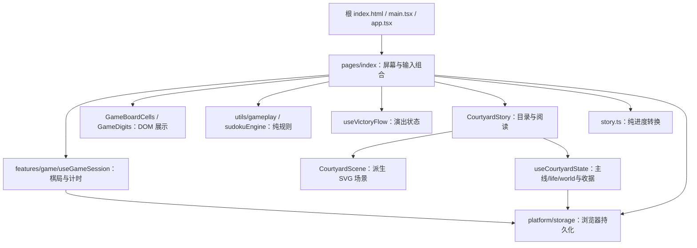

# 旧院 2.0 候选架构与故事契约

本文件描述当前源码，不是发布说明或用户合并批准。基线为 v1.3.0 `38829ab`；当前分支为 `feat/courtyard-redesign`，包版本2.0.0仅候选。线上仍是既有v1.3.0。完成候选PR、独立审阅与检查后等待用户最终审核；本轮不合并、不推main、不部署、不打tag、不发布。

## 为什么使用原生 Web

产品当前只输出浏览器，81格与文字、焦点、点击目标天然适合 DOM。使用 React18/Vite 代替 Taro H5/Webpack，保留纯数独算法和原生按钮，不额外引入 Canvas 引擎、ECS、状态库或每帧循环。换构建器并不自动解决职责耦合：主页面仍负责输入、菜单、提示与首次胜局组合，以下模块建立可独立检查的边界。

`vite.config.ts` 默认base为`/`，`GITHUB_PAGES=true`时为`/SudokuTaro/`。根模板使用`#app`和viewport-fit。旧`#/pages/index/index`及query仍进入同一个单页入口，不依赖新增路由或服务端history fallback。脚本`dev:h5/build:h5`保留兼容名称，实际由Vite运行，Node要求>=22.12.0。

## 规则、会话与演出

纯规则层继续生成唯一解、按线索数分档、检查冲突、候选、提示及撤销。给定格只读；简单按当前行列宫禁用数字，中高难度允许手工候选；所有难度正式冲突填数均被拒绝。线索数量不是专业技巧评级。

`useGameSession(paused)`拥有唯一当前game、保存效果和计时。菜单或故事打开时暂停，页面隐藏时不增加秒数。`Game.sessionId`是兼容旧档的可选字段；有效旧档读取后补ID并保存，新局赋新ID。`history`存档时清空，刷新后不可撤销之前操作；undo只恢复棋盘与笔记，不重写累计统计。

页面首次观察新胜局时通过同步ref防重复，分别更新纪录与调用`useCourtyardState.complete`，由`applyCourtyardCompletion`决定奖励域。旧完成存档启动时已经标为完成，恢复不重新记胜或解锁。`useVictoryFlow`只拥有wave/seams/cancel等呈现生命周期；两段真实animationend推进结果，不承担记分。刷新、结果卡、再赏、切语言均不是获章事件。减少动态效果直接结果，hidden或取消按既有语义结束演出。

## 存档边界及限制

| key | 用途 |
|---|---|
| `sudokutaro:glass:v1` | 旧棋局格式，补兼容sessionId，history不持久化 |
| `sudokutaro:records:v1` | wins与各难度best，过滤非法值 |
| `sudokutaro:language` | `zh/en` |
| `sudokutaro:vibration` | 用户偏好；有效振动另受API能力约束 |
| `fangcun:courtyard:v1` | 独立版本化故事状态 |
| `fangcun:courtyard:revealed:v1` | 一次物件显现收据，不发章、不标已读 |

`platform/storage.ts`提供可注入`StorageLike|null`的读取／写入方法。坏JSON、异常或缺失存储安全回退；写入返回boolean，棋局或故事进度保存失败显示提醒，内存中的游戏仍可继续；呈现收据等辅助写入不提供逐项失败提示。localStorage没有跨key事务；断写、清除数据、多标签同时写入、跨设备同步均未获事务性保障。存储不可用不保证刷新后保留。旧经济模块保留历史兼容用途，不是当前道具收费规则。

## 八篇有限故事

非程序读者可直接审阅[完整中英故事（含结局）](../story/COURTYARD_STORY.md)，正文从当前源码逐字导出，具体角色／对白仍待用户最终审核。

《院子留一盏灯》由林禾、姐姐林照与邻居陶姨组成。林禾从“修旧院让姐姐搬回”走向“邀请可以不规定别人的生活”；照顾通过具体商量而非默认义务展开。八篇均有完整中文与英文，第一卷明确结束，不连接账号、真实日历、活动预约、模拟经营或无限生成剧情。

| 章 | 中文标题 | 场景 token |
|---|---|---|
| 01 | 门灯 | doorLight |
| 02 | 窗边的薄荷 | mint |
| 03 | 没修成的窗 | window |
| 04 | 椅子朝哪边 | chairs |
| 05 | 留下的线头 | mendedCloth |
| 06 | 风铃不必一样 | windChime |
| 07 | 门上的小纸牌 | doorNote |
| 08 | 今晚的院子 | windowLight |

首篇免费，每个首次新胜局至多再开一篇，最多七个获章session。所有难度、免费提示平等；旧wins不倒填，升级前仍在进行的棋局首次合法完成可以计入。没有体力、签到、等待、付费或广告门槛。

`CourtyardProgress`实际结构为`{version:1, unlockedThrough:0..7, readChapterIds:string[], creditedSessionIds:string[], mode:'story'|'sudoku'}`。`isCourtyardProgress`检查范围、白名单、去重和ledger长度等于解锁索引；非法故事状态回退首章。`advanceCourtyard`为纯函数，拒绝重复session和超出上限；满篇后ledger不再增长。`markChapterRead`仅接受已解锁ID。场景由最新解锁索引派生，不另存八个可漂移布尔值，回看不倒退真实院子。

`CourtyardStory`在既有单一dialog中显示；语言／关闭位于头部，只有可聚焦reader内部滚动，翻页固定可达。切篇／切语言重置阅读滚动；边界按钮禁用前将焦点送回reader，关闭恢复入口。只玩数独仅关闭通知，继续累计解锁，手动入口和已读内容保留。读故事不会改棋盘，打开会暂停当前计时。

## 美术与反馈

原创AI辅助的SVG/CSS/叙事以暖瓷、墨绿、纸页、旧木与铜金形成同一材质系统；文字保留DOM。无外部图片、纹理、字体或特定在世艺术家模仿，未使用图片生成工具。八阶段SVG含薄荷、铜把手、不同朝向椅、绿色缝线和门牌；门牌正文为真实DOM文字。资产出处与许可见[清单](../art/courtyard-assets.json)。

普通成功落笔140ms局部显现，首次完成行列宫260ms柔光，不读取solution判断完成；撤销再填不重复首次单元反馈。新物件600ms一次淡入，不改变正文已读状态；门灯9s、风铃8s低幅循环。hidden/reduced停止相关动画，关闭卸载清理生命周期。原通关wave→seams与再赏保留，不用输入错误惩罚场景或人物。

## 持久世界与有限日常增量

新参考的[研究采用记录](../CLAUDE_GAME_STUDIOS_ADOPTION.md)说明Codex适配与许可，不代表安装Claude hooks。此次保留主线结局，增加可保存的表达和主线后内容，而非真实日历运营或无限故事。完整[十二笺中英审核稿](../story/COURTYARD_LIFE_NOTES.md)逐字来自`lifeNotes.ts`。

`world.ts`定义`CourtyardWorld = {version:1, atmosphere:'day'|'dusk'|'rain', motion:'ambient'|'still', favoriteObjectId}`。默认暮色／环境动态／无偏爱。氛围由玩家选择，不依据真实日期；只改变场景，不改变解题或奖励。`objects.ts`是八件物件名称／描述／开放章节的中英内容源；仅能观察和偏爱已修复物件，偏爱可取消，不生成完成事件。

`life.ts`定义`CourtyardLife = {version:1, creditedSessionIds:string[], readNoteIds:string[]}`，最多12个信用，已读仅能指向已开放笺。`applyCourtyardCompletion({progress,life},sessionId)`先验证两域、跨两ledger去重，再依据事件前状态分配：主线索引小于7时只开主线一篇；已满主线后才开日常一笺；十二笺满后不增长。故解锁第八篇的同一胜局不双发，刷新、再赏、打开目录／正文、切语言／氛围不发奖。通知关闭仍按真实新胜局累计。

`useCourtyardState`聚合主线与life完成状态和world偏好，纯updater外部effect写存储；它拥有`complete/readChapter/readLifeNote/setMode/chooseAtmosphere/chooseMotion/chooseFavorite`等命令。呈现收据也由该hook拥有，`preparePresentation`在实际庭院挂载时消费当前主线／life显现机会，优先最新日常；写收据不标已读、不解锁。UI组件不再直接读写存储。主线及日常收据分别跟踪、支持当次内存fallback；关闭／隐藏／静止／reduced时停止显现，取消不留到下次补播。

新增key：

| key | 用途 |
|---|---|
| `fangcun:courtyard:world:v1` | 氛围、静止和偏爱 |
| `fangcun:courtyard-life:v1` | 十二笺完成信用和已读 |
| `fangcun:courtyard-life:revealed:v1` | 日常物件一次显现收据 |

既有主线、游戏、纪录与设置key不变。辅助存档JSON/ID/重复/范围防御加载；任一故事／world／life／收据写失败汇总为保存提醒，当次内存仍可玩。两域内存一起转换不等于localStorage跨key事务，跨key中断／多标签并发限制仍保留。

`CourtyardLifeDetails.tsx`按已获笺数派生六组物件各两层：薄荷、窗边、椅子、桌布、风铃、门边。到第12笺时杯子从先前位置归到桌边，不以重复物件假装进展。日常600ms一次淡入与原主线显现分离；场景标题／描述按语言说明状态。庭院world控件、物件观察、主线目录和日常目录共用内部reader；页头／关闭／翻页保持固定。静止庭院优先于环境动态，系统reduced和hidden也停止相关动画。

## 证据和已知范围

同一冻结61文件候选已通过typecheck、60逻辑、无warning根／Pages构建、原庭院及新世界专项、增强1176几何（含文字内部边界，0失败）、完整根441.30s／Pages451.73s浏览器，runtimeErrors=[]。冻结检查结束源码未变。截图、视频、状态fixture、源码与产物摘要、同机资源量测和审阅范围均见[候选审核入口](../reviews/COURTYARD_V2_CANDIDATE.md)，不把旧版本证据套到本轮。

JS总原始／gzip字节为243973／83424，基线为341052／114278；CSS为54725／10484，基线45430／9062。资源变化不证明真机FPS、触感、启动或留存改善。程序几何不等于原生交互，AI抽帧审阅不等于真人长期试玩。未做真实移动设备、屏幕阅读器或30分钟真人soak。localStorage跨key／多标签限制仍保留。

准确head远端CI和代码审阅以实际PR为准，最终用户审核仍pending；线上保持既有v1.3.0，本轮未合并／部署／tag／release。
